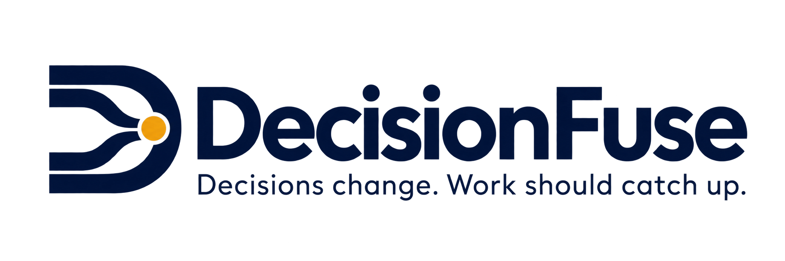
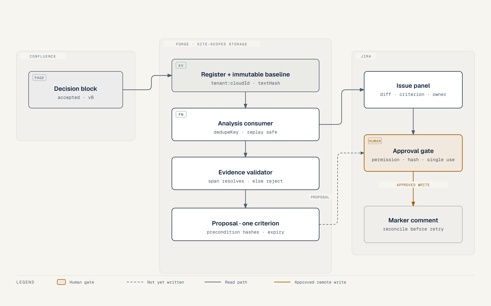

# DecisionFuse

<picture>
  <source media="(prefers-color-scheme: dark)" srcset="assets/decisionfuse-logo-dark.png">
  
</picture>

Decisions change. Work should catch up.

Catch Jira work that no longer matches a linked Confluence decision. DecisionFuse shows the evidence, proposes an exact correction or a scope reduction, and lets an authorized owner approve it. It never closes tickets on its own and never claims to remove all technical debt.

Category: Apps for Software Teams (Atlassian Codegeist 2026).

## Demo

[Watch the demo — 2:23](https://www.youtube.com/watch?v=nLg7tp5BkcY)

The drift, the review loop, the architecture, then a recorded run on a development site: the real finding, the exact proposed change, and a stale approval refused with nothing written. The same cut is also a [35 MB MP4 release asset](https://github.com/yablokolabs/decisionfuse/releases/download/demo-2026-11-01/decisionfuse-demo-2m23.mp4) rather than a file in this repository, because a 35 MB binary does not belong in git history. The music bed is royalty-free and generated by Claude for this project; [`THIRD_PARTY_NOTICES.md`](THIRD_PARTY_NOTICES.md) records the basis.

## What runs today

Installed on the development site `yablo.atlassian.net`, verified 2026-11-01:

- Forge app `ari:cloud:ecosystem::app/42074d3d-8872-4475-850b-8a75eb4d10b4`, deployed to `development` as v3.1.0, eligible for the Runs on Atlassian program.
- Production deployed as **2.0.0** on 2026-11-02, also eligible for Runs on Atlassian. The judge installation link in [`docs/JUDGE_SETUP.md`](docs/JUDGE_SETUP.md) installs this build, for Jira and Confluence.
- Installed separately for **Jira** (`e63b5663-a630-468b-883a-cfcaf946d437`) and **Confluence** (`ca73eaa3-ea71-4e76-a8e9-89cf74520fe2`). A Jira install does not grant Confluence access; both were required.
- `forge lint` reports **No issues found** for the full manifest: Jira issue panel, Confluence byline module, resolver, queue consumer, three `action` modules, `rovo:agent` and `rovo:mcp`.
- `npx tsc --noEmit` clean; `npx vitest run` **49 tests passing** across six suites, plus a gated live-site suite.
- The engine, proposal builder and approval gate ran against live site content: a withdrawn accepted decision flagged only the criterion sitting in the changed clause, reported the second linked criterion `unaffected`, left the unlinked control alone, produced exact proposal text, and rejected a stale approval without writing. See [`evidence/2026-11-01-live-engine.md`](evidence/2026-11-01-live-engine.md).
- Deterministic domain: block extraction, formatting-insensitive hashing, span diffing, classification, evidence validation, proposal-bound approval, single-use approvals, tenant partitioning, replay-safe findings, reconcile-before-retry.
- Deterministic proposals: the criterion sentence sharing the decision's subject is replaced and the rest is preserved; no shared subject means no proposal rather than a guess.
- Read-only tool layer shared by the Rovo agent and the MCP server, with input allow-lists and fail-closed permission checks.

Synthetic scenario seeded on that site: project `DFS` with `DFS-1`/`DFS-2` and the unaffected control `DFS-3`, plus Confluence page `426003` holding an accepted `checkout-guest` decision block. `npm run seed:synthetic` rebuilds it idempotently. See [`evidence/2026-11-01-site-install.md`](evidence/2026-11-01-site-install.md).

Not yet verified — do not assume it works:

- The review loop has not run through the Forge runtime. Register, link, rescan, propose and approve are resolver calls reached only from the panel in a signed-in browser session, which this build environment does not have. The domain has run against live content over REST, but nothing has been written to Jira or Confluence by the app itself.
- The Rovo agent and MCP server have **never been invoked**. No admin has enabled external MCP exposure: the app endpoint returns 404 while the MCP server's own OAuth metadata returns 200. Bonus eligibility is not claimed.
- A browser-free runtime hook was attempted and failed: a token-gated web trigger needed a major-version approval, dropped Runs on Atlassian eligibility, then returned `424` on every call without reaching the handler. It was reverted and eligibility restored. See [`evidence/2026-11-01-runtime-proof-attempt.md`](evidence/2026-11-01-runtime-proof-attempt.md).
- No reviewer-without-write-permission or denied-source-access accounts exist on the site. Those paths are covered only by mocked tests. [`scripts/fixture-permissions.mjs`](scripts/fixture-permissions.mjs) records both once a second identity exists and exits 3 naming the requirement until then.
- The production build has never been installed anywhere, so a judge following the install link would be the first to exercise it. Distribution is set to **Sharing with anyone** (2026-11-02), which is the status that permits an install from outside the owner's organization; the install itself is still untried. See [`evidence/2026-11-02-distribution-status.md`](evidence/2026-11-02-distribution-status.md).
- Teamwork Graph is not used. No Marketplace listing exists; the Marketplace bonus is not claimed.

## Architecture



Source: [`assets/architecture.svg`](assets/architecture.svg). The dashed edges are proposals that have not been written and the read-only surface; the amber edge is the only remote write, gated by a fresh permission and hash recheck.

## How the review loop works

1. **Register.** A decision block inside a Confluence page is registered with an owner, a status and a baseline page version. Only `accepted` blocks are actionable.
2. **Link.** Issues are linked explicitly, criterion by criterion. No guessed links.
3. **Compare.** A changed block is compared against the baseline. Formatting-only edits are ignored.
4. **Classify.** Requirement conflict, obsolete scope, implementation review, or uncertain. Contradictory accepted decisions stay unresolved.
5. **Validate.** Every finding must carry spans that resolve against the exact stored source and criterion text, or it is rejected.
6. **Propose.** The proposal is one criterion with exact replacement text, precondition hashes and an expiry.
7. **Approve.** A permission-checked, single-use approval bound to the proposal hash and the live source and issue versions.
8. **Write and reconcile.** A marker-tagged comment carries the amendment, so a timeout reconciles instead of posting twice. Scope removal stays a recommendation on the native workflow.

## Rovo agent and MCP tools

Both surfaces call the same read-only actions, so they cannot diverge from the review flow:

| Tool | Answers |
| --- | --- |
| `inspect_decision_change` | What is the registered baseline, and which issues are flagged? |
| `list_affected_work` | Which issues are linked, and what is the evidence for each? |
| `get_proposal` | What is the exact proposed text, and its preconditions? |

Safety properties enforced in code and tested:

- Tenant identity is not an input. Forge storage is installation-scoped, so a caller cannot name another site.
- `blockId` and `proposalId` must match a plain identifier pattern. No URLs, API paths or queries reach the platform.
- A source the caller cannot read returns a bare denial with no title, count, span or hint.
- Issues the caller cannot browse are omitted, and the response flags that evidence was withheld.
- No tool exposes an approval, and none can mutate or transition anything. `get_proposal` returns the review path instead.

The agent prompt keeps the same boundary: it explains and quotes evidence, and always directs the user to approve in the authenticated Jira panel.

## Run the checks

```bash
npm install
npm run typecheck
npm test
forge lint
(cd static/hello-world && npm install && npm run build)

# Synthetic Jira project + Confluence page; idempotent, same credentials
npm run seed:synthetic

# Real-site domain check; needs FORGE_EMAIL and FORGE_API_TOKEN in the environment
DECISIONFUSE_LIVE=1 npx vitest run tests/live-site.test.ts

# Denied-access paths; exits 3 and names what is missing when no second identity is set
node scripts/fixture-permissions.mjs
```

The live suite seeds the scenario itself and deletes the page it creates, so a run leaves nothing behind.

## Project layout

| Path | What it holds |
| --- | --- |
| `manifest.yml` | Forge modules, scopes and runtime |
| `src/domain` | Types, text and hashing, classification, evidence, approval gate |
| `src/queue` | Idempotent analysis engine |
| `src/review` | Approved apply path with remote reconciliation |
| `src/actions` | Read-only tools shared by Rovo and MCP |
| `src/services` | Jira and Confluence reads and the marker comment |
| `src/storage` | Tenant-partitioned repository and the Forge KV adapter |
| `static/hello-world` | Review panel bundle |
| `tests` | Domain, permission, concurrency, reconciliation and tool tests |
| `docs` | Build spec, verification notes, evaluation scenarios, progress |
| `videos/decisionfuse-demo` | Remotion walkthrough. This tree renders 3:23: drift, review loop, architecture, then a recorded run with the real finding and stale refusal. The `out/video.mp4` beside it is a **2:23 owner re-cut** with a music bed and an animated architecture scene, whose source is not in this repository — see [`evidence/2026-11-01-owner-recut.md`](evidence/2026-11-01-owner-recut.md). Logo in the intro and outro; narrated with piper `en_GB-alba-medium` after ElevenLabs refused on its free-tier cap (see `evidence/2026-11-01-narration.md`) |

## Competition notes

The uploaded brief is preserved in `docs/COMPETITION_BRIEF.txt`. Official listing checked November 1, 2026: deadline December 22, 2026 12:00 PST. Recheck the official rules before submitting, and read `docs/PLATFORM_VERIFICATION.md` for what is verified versus merely declared. Public posting, Marketplace submission and the final competition entry remain the owner's decisions.

## License

MIT for this repository; third-party obligations and Atlassian trademark notes are in `THIRD_PARTY_NOTICES.md`.
